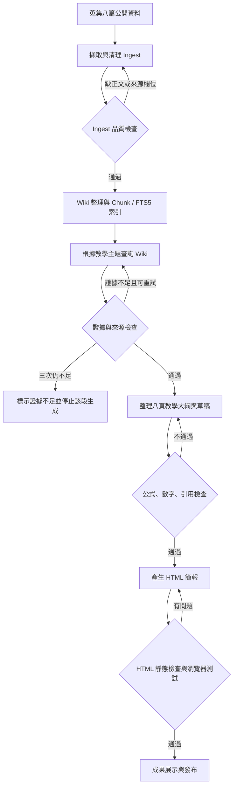

# Financial Statement Analysis 101 — Workflow / Graph 與反思報告

## 1. 專案介紹與成果

本專案以「財務報表分析入門」為主題，目標是讓非會計背景學習者理解三大財務報表、獲利能力、短期償債能力、營運效率及財務警訊。依照「先討論、後生成」的順序，先在 Antigravity 討論 Wiki 的知識架構，再匯入公開資料，建立 Markdown Wiki 和 SQLite FTS5 檢索庫，最後根據 Wiki 製作八頁互動式 HTML 教學簡報。

**可直接確認的成果**：已提供的 `wiki_fts.db` 內含 211 筆 Chunk，包括來自八個來源的 181 筆原始資料 Chunk，以及 30 筆整理後的 Wiki Chunk；資料庫存在 `chunks_metadata` 和 `chunks_fts` 表。已提供的修正版 HTML 含八個 `<section class="slide">` 主要投影片及來源彈窗與小測驗的程式碼。原始來源包含 SEC、SBA、CFI 與 Wikipedia；Wikipedia 為協作百科，非同儕審查資料庫。

**展示方式**：`index.html` 提供可公開瀏覽的 Wiki 摘要；`slides.html` 提供教學簡報。公開網站上的 Wiki 搜尋只是前端文字篩選，**不是**即時 LLM 或 FTS5 伺服器檢索。完整的 FTS5 檢索是在本機專案中完成。

## 2. Loop / Graph 流程設計

每個節點都有明確輸入、輸出與失敗條件。檢索不足時應保留原始問題意圖，最多重試三次；若仍沒有支持資料，停止該段內容生成，避免把不相關證據硬套進去。不同錯誤回到不同節點，而不是每次重新執行整個流程。

| 節點 | 輸入 | 輸出 | 檢查條件 |
|---|---|---|---|
| Ingest | 來源網址或原文 | 原始 HTML、清理正文 | 正文非空、來源可追溯、至少五篇 |
| Wiki / Index | 清理正文、整理後 Markdown | Chunk、SQLite FTS5 | 欄位齊全、索引可搜尋 |
| Retrieve | 教學主題查詢 | 帶 Chunk ID 的段落 | 內容與查詢意圖相符 |
| Evidence Check | Wiki 段落與原始出處 | 來源判定結果 | 不把摘要冒充精確引述 |
| Draft | 已通過的資料 | 八頁大綱 | 適合初學者，避免無根據結論 |
| Financial Check | 公式與虛構案例數字 | 數字驗證結果 | 平衡、公式及口徑一致 |
| HTML / Test | 已檢查草稿、程式碼 | HTML 和測試結果 | 換頁、來源、測驗和顯示正常 |

## 3. 實際執行及檢查紀錄

以下區分「本次已提供檔案可獨立查證」和「Antigravity 的執行回報」，避免將回報誤寫成已查閱的原始日誌。

**A. Ingest 解析器問題（Antigravity 回報）**：第一次清理 HTML 時，解析器未正確處理部分 HTML void tags，導致正文為空，觸發資料品質檢查；更換解析器並重新 Ingest 後，八篇來源最終收錄於資料庫。此問題的完整原始錯誤與時間戳仍須以本機 `logs/error_log.json`、`logs/data_quality_check_log.json` 為準。

**B. SQLite 檢索修正（Antigravity 回報與檔案佐證）**：檢索程式曾將 `bm25()` 傳入別名，產生查詢錯誤；修正為 FTS5 虛擬表名並改善中文斷詞後，建立可查詢的全文索引。從交付的資料庫可查見 `chunks_fts` 與 `chunks_metadata` 及 211 筆索引資料；但當初錯誤堆疊未隨檔上傳，不能聲稱已親自查證錯誤日誌。

**C. 財務案例檢查（Antigravity 回報）**：虛構案例曾有資產負債表不平衡，調整示例數據後重新驗證。案例為自製教學模型，不是 SEC、CFI 或真實上市公司財報；報告所述修正歷程需配合 `logs/financial_validation_log.json` 截圖或檔案佐證。

**D. 來源追蹤檢查（已比對 SQLite 與 HTML）**：資料庫部分 `raw_quote` 含整理後的 Wiki 中文說明，不可直接標示為原始英文文獻逐字引述。因此將 UI 引用類型改成「Wiki 整理摘要」或「自製教學案例」，並保留 Chunk ID、來源 URL。來源 URL 存在只證明可追溯，**不等於**每一個主張已經逐句語意驗證。

**E. HTML JavaScript 修正（已由 ChatGPT 檢查）**：上傳的早期版本出現重複宣告 `CITATION_DATA`，JavaScript 語法檢查報錯；修正版移除衝突並補齊多來源引用及測驗資料。修正版的 JS 使用 Node 語法檢查無誤；此為語法層檢查，不取代瀏覽器實際操作。

**F. Safari 人工測試（使用者實際操作）**：使用者在 Mac Safari 開啟修正版，成功打開與關閉 Wiki 溯源矩陣、以左右方向鍵切換投影片，並完成第八頁三題互動測驗且看到回饋。已提供 Safari 來源矩陣截圖。完整跨裝置視覺測試及 Chrome 自動化測試尚未獲得證據，不宣稱已通過。

## 4. 哪個節點最容易出錯？

從本次可確認的問題類型看，**來源引用與內容一致性檢查**是影響成品質量的重要節點：檢索結果有正確 ID 不代表 `raw_quote` 為原文；而 HTML 的引用資料結構在後續修改時也曾衝突。Ingest、FTS5 檢索和 HTML 程式亦曾出錯。因未取得完整 `error_log.json`，**目前不能以錯誤次數斷言哪個節點統計上最多錯誤**；若要回答嚴格的「最常出錯」，應先依實際 Log 分類計數再下結論。

## 5. 檢查如何前移？為什麼？

原本在產生 HTML 之後才檢查引用，發現 Wiki 整理文字被當成原始文獻。改善後將「來源證據檢查」設在 **Retrieve 與 Draft 之間**，先分類原始引述、Wiki 摘要及虛構案例，才允許進入草稿。也在 Ingest 後設正文與來源欄位檢查，在 HTML 生成前執行公式及案例數字驗證。

如此可以在錯誤尚未擴散到八頁簡報之前阻止它，減少重工、避免引述失真，也使每次失敗能回到正確節點重試。這是流程設計的改善；是否真的降低耗時，尚無前後量化數據，故不聲稱有特定百分比改善。

## 6. 限制、發布與繳交說明

- 公開 HTML Wiki 是根據已建置資料庫的**靜態匯出展示**；GitHub Pages 不會執行 Python 或 SQLite FTS5。若要展示完整本機檢索流程，可附上 `retrieval_test_log.json`、程式碼截圖或錄影。
- 目前引用是帶有來源 URL 的 **Wiki 摘要**；部分主張尚未逐句核對原文，不能標示成 `VERIFIED_EXACT`。
- 原本 Antigravity 的 7 項靜態／模擬檢查為 PASS、1 項真實瀏覽器排版 NOT TESTED。之後使用者已在 Safari 人工驗證主要互動功能，但不代表完成所有瀏覽器及螢幕尺寸測試。
- 需把 `index.html`、`slides.html` 放到 GitHub Pages 公開目錄，將實際網址貼回作業；發布前無法先宣稱有公開連結。
- 本報告以交付的 HTML、SQLite、使用者確認與 Antigravity 回報整理；其他本機原始 Log 尚未上傳，不能替代完整紀錄。
